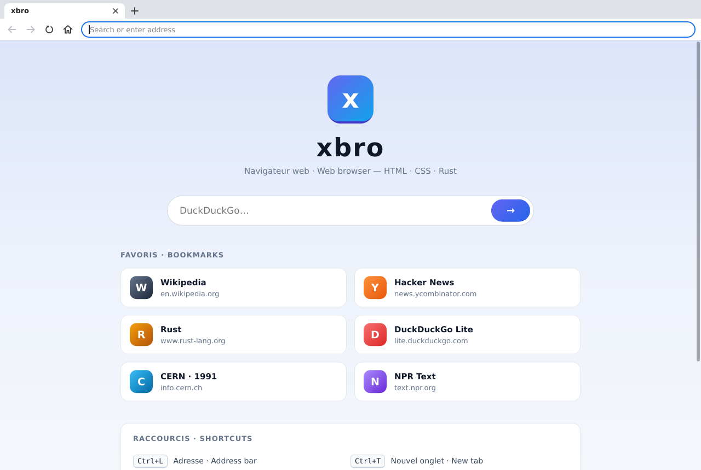
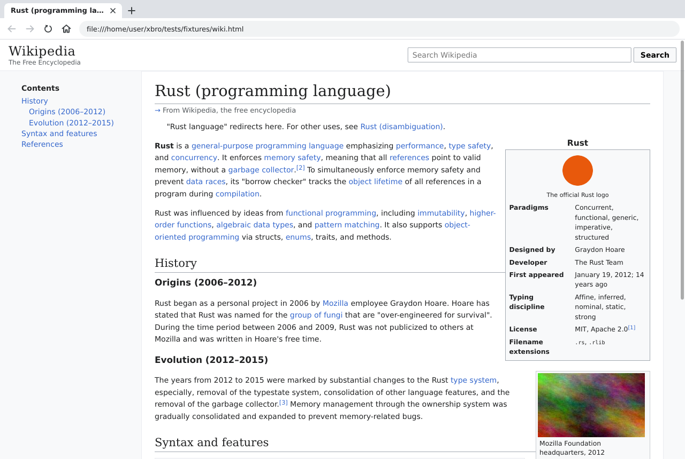
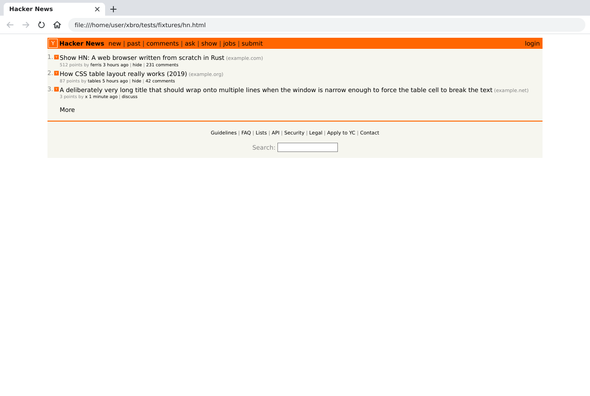
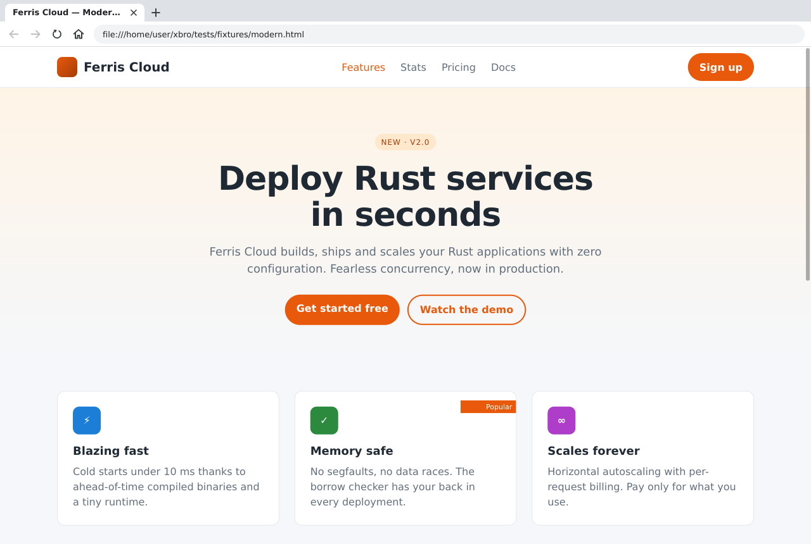
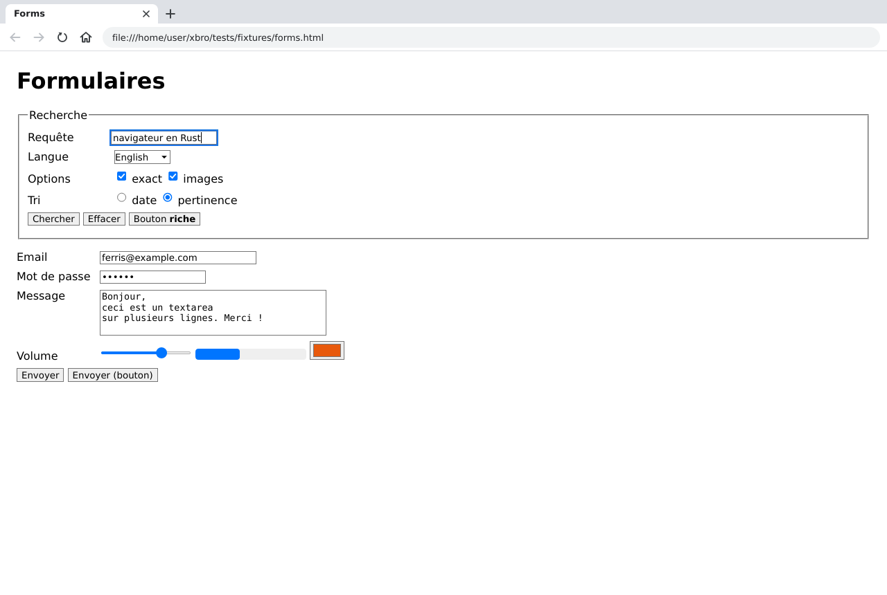
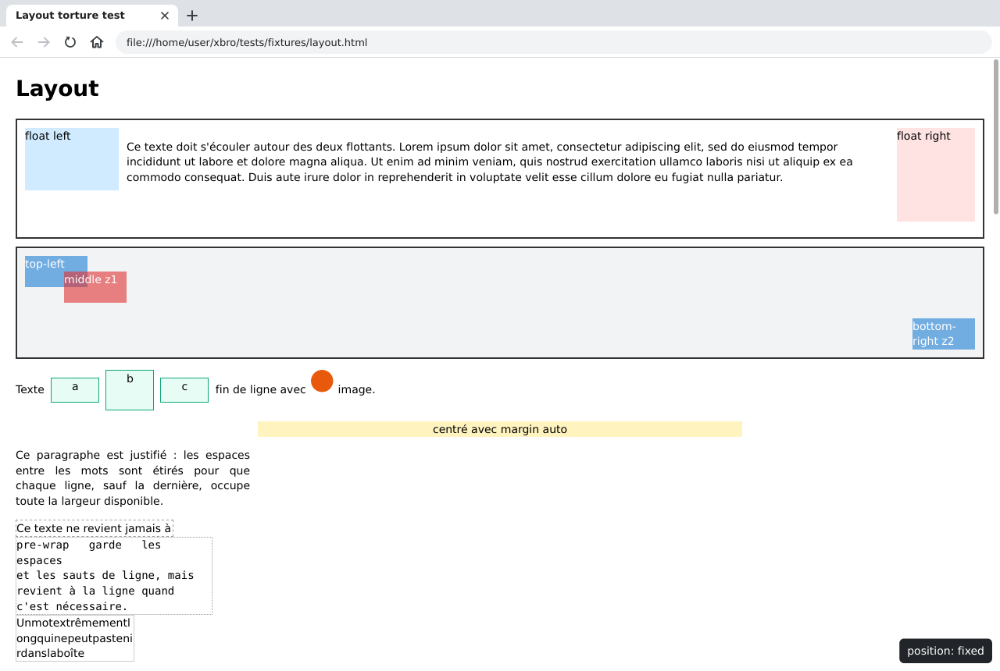

# xbro

**xbro** est un navigateur web écrit en Rust, **avec son propre moteur de
rendu**. Le décodage et le parseur HTML, le parseur CSS, la cascade, la mise
en page et la construction de la liste d'affichage sont implémentés de zéro
dans ce dépôt ; seules les briques « système » viennent de crates externes :
HTTP/TLS (`ureq` + `rustls`), découverte et lecture des polices (`fontdb`,
`ab_glyph`), décodage d'images (`image`, `resvg`), dessin 2D (`tiny-skia`),
fenêtre (`winit` + `softbuffer`) et presse-papiers (`arboard`).

> Il n'y a **pas de JavaScript** : xbro affiche le Web « document »
> (Wikipédia, Hacker News, blogs, documentation, DuckDuckGo HTML…). Le
> parseur fonctionne « scripting désactivé », les balises `<noscript>` sont
> donc rendues.

## Captures d'écran

| Page d'accueil (`about:home`) | Article façon Wikipédia (`tests/fixtures/wiki.html`) |
|---|---|
|  |  |
| **Hacker News** (`tests/fixtures/hn.html`) | **Mise en page moderne** (`tests/fixtures/modern.html`) |
|  |  |
| **Formulaires** (`tests/fixtures/forms.html`, champs remplis) | **Cas tordus de mise en page** (`tests/fixtures/layout.html`) |
|  |  |

Captures de la fenêtre (1280×860) prises sous Xvfb, voir
[CONTRIBUTING.md](CONTRIBUTING.md).

## Fonctionnalités

**Moteur**

- HTML : décodage (BOM, `charset` HTTP, `<meta charset>`, sinon UTF-8 ou
  windows-1252), tokenizer et construction d'arbre façon WHATWG (modes
  d'insertion, fermetures implicites, algorithme d'adoption des éléments de
  formatage mal imbriqués, foster parenting des tableaux, `<template>`, SVG et
  MathML en ligne, entités nommées et numériques), mode quirks.
- CSS : syntaxe CSS 3 avec récupération d'erreurs, sélecteurs niveau 4
  (`:is`, `:where`, `:not`, `:has`, `:nth-child`, `:lang`, `:dir`,
  `:focus-within`…), `@media` (niveau 4, syntaxe d'intervalle comprise),
  `@supports`, `@import`, imbrication CSS (nesting), propriétés
  personnalisées (`var()`), `calc()`/`min()`/`max()`/`clamp()`, couleurs CSS
  Color 4/5 (`oklch()`, `color-mix()`, `light-dark()`…), raccourcis,
  attributs de présentation HTML (`bgcolor`, `width`, `align`, `<font>`…).
- Mise en page : bloc (fusion des marges), texte (coupure de lignes,
  justification, `white-space`, `vertical-align`, `overflow-wrap`,
  `word-break`), flottants et `clear`, positionnement relatif/absolu/fixe,
  listes et marqueurs, flexbox, grille CSS (dimensionnement des pistes,
  placement par numéros de lignes, `repeat(auto-fill/auto-fit)`), tableaux
  (`colspan`/`rowspan`, `table-layout`, bordures fusionnées, légendes),
  `fieldset`/`legend`, images, SVG en ligne, contrôles de formulaire,
  `::before`/`::after`, `display: contents`, `aspect-ratio`.
- Peinture : ordre d'empilement CSS 2.1 et `z-index`, `opacity`, `overflow`
  (découpage, coins arrondis compris), bordures (tous les styles, rayons),
  dégradés linéaires, images de fond (`repeat`, `size`, `position`), contour
  (`outline`), soulignement/surlignement/barré, texte anti-crénelé avec
  repli de police par caractère, gras et italique synthétiques.
- Images : PNG, JPEG, GIF (première image), WebP, BMP, ICO, SVG ; `srcset`,
  `<picture>`, orientation EXIF.
- Réseau : HTTP/1.1 + TLS (rustls, racines Mozilla), redirections, cookies
  (en mémoire), gzip/brotli, proxys de l'environnement, `file:` (avec listing
  des répertoires), `data:`, pages internes `about:home`, `about:help` et
  `about:blank`.

**Navigateur**

- Onglets, historique précédent/suivant par onglet (position de défilement
  restaurée), barre d'adresse (URL, domaine, chemin local ou recherche
  DuckDuckGo), titre de fenêtre, bulle d'état (lien survolé, chargement).
- Liens, ancres `#id`, cartes d'images (`<map>`/`<area>`), formulaires GET et
  POST (champs texte, zones de texte, cases à cocher, boutons radio, listes
  `<select>`, boutons, réinitialisation), `<label>`, `<details>`/`<summary>`,
  `<meta http-equiv=refresh>`, `:hover` et `:focus`.
- Défilement (molette, clavier, barres de défilement), zoom de 50 % à 300 %,
  recherche dans la page (insensible à la casse, surlignage des
  occurrences), navigation au clavier entre liens et champs.
- Modes sans fenêtre : capture PNG, dump du DOM ou de l'arbre de mise en page.

## Démarrage rapide

### Prérequis

- **Rust ≥ 1.85** (installé avec [`rustup`](https://rustup.rs)) ; l'édition
  est 2021.
- **Un compilateur C** (`cc`, paquet `build-essential` sous Debian/Ubuntu) :
  la crate `ring`, utilisée par `rustls` pour le TLS, en compile une partie.
  Aucun paquet `-dev` n'est nécessaire : les bibliothèques de fenêtrage sont
  chargées dynamiquement à l'exécution.
- **Des polices installées** (DejaVu, Liberation, Noto…), trouvées
  automatiquement (dossiers système et configuration fontconfig, lue en
  Rust). Sans aucune police, le texte est mesuré mais invisible.

Le développement et les tests se font sous Linux. Le code vise aussi macOS et
Windows (`winit` et `softbuffer` sont multiplateformes ; sous macOS, `Cmd`
remplace `Ctrl` dans les raccourcis).

### Compiler et lancer

```sh
cargo build --release                     # binaire : target/release/xbro
cargo run --release                       # ouvre about:home
cargo run --release -- tests/fixtures/modern.html
cargo run --release -- https://en.wikipedia.org/wiki/Rust_(programming_language)
cargo run --release -- "recherche libre"  # recherche DuckDuckGo
```

Le workspace a `crates/xbro` comme membre par défaut : `cargo run` lance donc
le navigateur sans `-p xbro`. Préférez `--release` : en debug, le moteur est
compilé en `opt-level = 1` et les pages lourdes sont nettement plus lentes.

L'argument est interprété comme une saisie dans la barre d'adresse :

| Saisie | Interprétation |
|---|---|
| vide | `about:home` |
| URL absolue d'un schéma connu (`https:`, `http:`, `file:`, `data:`, `about:`…) | telle quelle (les schémas non pris en charge, comme `ftp:` ou `mailto:`, donnent une page d'erreur) |
| chemin existant écrit `/…`, `./…`, `../…` ou `~/…` | URL `file://` (un dossier donne un listing) |
| sur la ligne de commande seulement : tout chemin existant, relatif au dossier courant (`tests/fixtures/wiki.html`) | URL `file://` |
| `localhost[:port]`, adresse IPv4 ou `[IPv6]` | `http://…` |
| texte sans espace ressemblant à un nom de domaine (`example.com/chemin`) | `https://…` |
| autre chose | recherche `https://html.duckduckgo.com/html/?q=…` |

### Options de la ligne de commande

```
xbro [OPTIONS] [URL]
```

| Option | Effet |
|---|---|
| `-s`, `--screenshot <FICHIER>` | rend la page dans un PNG au lieu d'ouvrir une fenêtre |
| `--dump-dom` | affiche l'arbre DOM et quitte |
| `--dump-layout` | affiche l'arbre de mise en page (boîtes, lignes, fragments) et quitte |
| `-w`, `--width <PX>` | largeur du viewport en px CSS (défaut 1024) ; en mode fenêtre, largeur initiale de la fenêtre |
| `-H`, `--height <PX>` | hauteur du viewport (défaut 768) ; `0` = page entière pour `--screenshot` |
| `--scale <FACTEUR>` | densité de pixels des captures, dans `]0, 8]` (défaut 1) |
| `-h`, `--help` / `-V`, `--version` | aide / version |

Code de sortie : `0` en cas de succès, `2` pour des arguments invalides, `1`
pour une autre erreur (fichier PNG non écrit, fenêtre impossible à ouvrir…).

### Modes sans fenêtre

Ils n'ont besoin ni d'écran ni de serveur graphique :

```sh
# Capture de la page entière (hauteur 0) en 1280 px de large
cargo run --release -- --screenshot page.png --width 1280 --height 0 news.ycombinator.com
# Capture HiDPI (2048×1536 pixels) d'une fixture
cargo run --release -- -s wiki.png -w 1024 -H 768 --scale 2 tests/fixtures/wiki.html
# Arbre DOM et arbre de mise en page
cargo run --release -- --dump-dom tests/fixtures/basic.html
cargo run --release -- --dump-layout tests/fixtures/basic.html
```

- La mise en page utilise la largeur demandée ; avec `--height 0`, le viewport
  fait 768 px de haut et l'image couvre tout le document (limitée à 32 768
  pixels de côté et 2²⁸ pixels au total).
- Les problèmes de chargement (feuille de style ou image introuvable, statut
  HTTP d'erreur…) sont affichés sur la sortie d'erreur, préfixés par `xbro:`.
- Une erreur réseau ne fait pas échouer la commande : comme dans la fenêtre,
  c'est la page d'erreur qui est rendue.

### Variables d'environnement

| Variable | Effet |
|---|---|
| `XBRO_FONT_DIRS` | dossiers (ou fichiers) de polices supplémentaires, séparés par `:` sous Unix (`;` sous Windows) |
| `HTTPS_PROXY`, `HTTP_PROXY`, `ALL_PROXY` (et leurs versions en minuscules, prioritaires) | proxy `http://` ou `https://` (les proxys SOCKS sont ignorés), choisi pour chaque requête et chaque redirection : `https_proxy` puis `all_proxy` puis `http_proxy` pour les URL `https:`, l'inverse pour `http:` |
| `NO_PROXY` / `no_proxy` | exceptions : noms d'hôtes, suffixes de domaine, IP, plages CIDR, ports ; `localhost`, `127.0.0.0/8` et `::1` sont toujours joints directement |
| `SSL_CERT_FILE` | fichier PEM de certificats racines remplaçant les racines Mozilla intégrées (utile derrière un proxy qui intercepte TLS) |
| `LC_ALL`, `LC_MESSAGES`, `LANG` | langue envoyée dans `Accept-Language` (ex. `fr_FR.UTF-8` → `fr-FR,fr;q=0.9,en;q=0.8`) |
| `HOME` | développement de `~` dans les chemins saisis |

Des variables réservées aux tests (`XBRO_DUMP`, `XBRO_REVIEW_DIR`,
`XBRO_FUZZ_ROUNDS`…) sont décrites dans [CONTRIBUTING.md](CONTRIBUTING.md).

### Exécution sous Linux

L'interface graphique utilise Wayland si `WAYLAND_DISPLAY` est défini, sinon
X11. Les bibliothèques sont chargées à l'exécution :

- **X11** : `libX11`, `libX11-xcb`, `libXcursor`, `libXrandr`, `libXi` et
  **`libxkbcommon-x11`** (Debian/Ubuntu : `libx11-6 libx11-xcb1 libxcursor1
  libxrandr2 libxi6 libxkbcommon-x11-0`) ;
- **Wayland** : `libwayland-client` et `libxkbcommon` (`libwayland-client0
  libxkbcommon0`).

Sans serveur graphique (ou si une bibliothèque manque, typiquement
`libxkbcommon-x11`), xbro s'arrête avec un message clair :
`cannot open a window (…); use --screenshot for headless rendering`. Pour
forcer X11 (XWayland) sous Wayland : `env -u WAYLAND_DISPLAY xbro`. Le
presse-papiers passe par X11 (XWayland sous Wayland). Pour lancer l'interface
sur un écran virtuel (Xvfb), voir [CONTRIBUTING.md](CONTRIBUTING.md).

## Raccourcis clavier et souris

Sous macOS, `Cmd` remplace `Ctrl` dans les raccourcis du navigateur. Les
raccourcis suivent le caractère produit par la touche ; pour les chiffres
(AZERTY : `Ctrl+&` vaut `Ctrl+1`) et les dispositions non latines, la
position physique de la touche sert de repli.

| Action | Raccourci |
|---|---|
| Barre d'adresse | `Ctrl+L`, `Alt+D`, `F6` (puis `Entrée` ; `Échap` annule) |
| Précédent / suivant | `Alt+←` / `Alt+→`, `Ctrl+[` / `Ctrl+]`, boutons latéraux de la souris (`Retour arrière` ne revient **pas** en arrière) |
| Recharger | `F5`, `Ctrl+R` ; pendant un chargement, le bouton recharger devient « arrêter » |
| Arrêter le chargement | `Échap` (hors barre d'adresse et barre de recherche) |
| Page d'accueil | `Alt+Début`, bouton maison |
| Nouvel onglet / fermer | `Ctrl+T` / `Ctrl+W`, clic du milieu sur un onglet (fermer le dernier onglet quitte) |
| Onglet suivant / précédent | `Ctrl+Tab` / `Ctrl+Shift+Tab`, `Ctrl+Page↓` / `Ctrl+Page↑` |
| Aller à l'onglet *n* | `Ctrl+1` … `Ctrl+8` ; `Ctrl+9` : dernier onglet |
| Rechercher dans la page | `Ctrl+F` ; `Entrée` / `Shift+Entrée`, `F3` / `Shift+F3`, `Ctrl+G` / `Ctrl+Shift+G` ; `Échap` ferme |
| Zoom | `Ctrl++` (ou `Ctrl+=`), `Ctrl+-`, `Ctrl+0`, `Ctrl`+molette ; un clic sur le badge « 125 % » de la barre d'adresse revient à 100 % |
| Défiler | molette (`Shift`+molette : horizontal), flèches, `Espace` / `Shift+Espace`, `Page↑/↓`, `Début`/`Fin` (aussi avec `Ctrl`), barres de défilement (glisser ou cliquer dans la piste) |
| Parcourir les liens et champs | `Tab` / `Shift+Tab` ; `Entrée` active ; `Espace` active une case à cocher, un bouton, une liste ou un `<summary>` (sinon fait défiler) |
| Ouvrir un lien dans un onglet en arrière-plan | `Ctrl+clic` ou clic du milieu |
| Quitter un champ de la page | `Échap` (un second `Échap` ferme la barre de recherche si elle est ouverte) |

Dans la **barre d'adresse** et le **champ de recherche** : flèches, `Début`,
`Fin`, sélection avec `Shift`, déplacement par mot avec `Ctrl+←/→`,
`Ctrl+Retour arrière` (effacer un mot), `Ctrl+A/C/X/V`, `Ctrl+Inser`,
`Shift+Inser`, `Shift+Suppr` ; à la souris, clic, glisser, double-clic (mot)
et triple-clic (tout).

Dans un **champ de la page** (`<input>`, `<textarea>`) : la saisie s'ajoute à
la fin du texte, `Retour arrière` efface le dernier caractère, `Ctrl+V` /
`Shift+Inser` collent, `Entrée` envoie le formulaire (nouvelle ligne dans un
`<textarea>`). Il n'y a ni curseur déplaçable ni sélection dans ces champs.

`about:help` rappelle ces raccourcis dans le navigateur.

## Comment ça marche

Chaque étape du pipeline est une crate du workspace :

```
 URL ──► xbro-net ──► octets ──► xbro-html ──► Document (xbro-dom, arbre en arène)
                                                   │
        <style>, <link>, @import ──► xbro-css ──► Stylesheet
                                                   │
                         xbro-style (cascade) ◄────┘  →  StyleMap : un ComputedStyle par nœud
                               │
                         xbro-layout (+ xbro-text pour mesurer le texte)
                               │  LayoutTree : boîtes, lignes, fragments (px CSS, coordonnées absolues)
                               ▼
                         xbro-paint ──► DisplayList ──► rastérisation tiny-skia ──► pixels
 xbro-engine orchestre le tout (Engine::load → Page) ; xbro = fenêtre + modes sans fenêtre
```

1. `xbro-net` charge l'URL (HTTP, `file:`, `data:`, `about:`) ;
2. `xbro-html` décode les octets et construit le `Document` ;
3. `xbro-engine` récupère les feuilles de style en parallèle, `xbro-css` les
   analyse ;
4. `xbro-style` applique la cascade et calcule un `ComputedStyle` par nœud ;
5. `xbro-engine` charge les images en parallèle (budget par page) ;
6. `xbro-layout` construit l'arbre de boîtes et le met en page ;
7. `xbro-paint` produit une liste d'affichage en px CSS, rastérisée à
   l'échelle voulue (HiDPI × zoom) et pour la seule zone visible.

Dans la fenêtre, chaque navigation est chargée sur un thread dédié ; le
thread de l'interface ne bloque jamais sur le réseau et reçoit la `Page`
terminée. Les détails (types, algorithmes, décisions de conception, limites
de robustesse) sont dans [ARCHITECTURE.md](ARCHITECTURE.md).

## Organisation du dépôt

```
xbro/
├── Cargo.toml            # workspace : membres crates/*, dépendances partagées, profils
├── Cargo.lock
├── README.md             # ce fichier
├── ARCHITECTURE.md       # conception détaillée, crate par crate
├── CONTRIBUTING.md       # compiler, tester, vérifier, conventions
├── crates/
│   ├── xbro-dom/         # arbre DOM en arène (Document, NodeId)
│   ├── xbro-html/        # décodage, tokenizer, construction d'arbre
│   ├── xbro-css/         # tokenizer, parseur, sélecteurs, media queries, couleurs
│   ├── xbro-style/       # cascade, valeurs calculées, feuille UA, var(), calc()
│   ├── xbro-text/        # polices système, sélection, repli, shaping simple, glyphes
│   ├── xbro-net/         # http(s), file:, data:, about: (src/about/*.html), saisie d'adresse
│   ├── xbro-layout/      # arbre de boîtes ; bloc, inline, flottants, flex, grille, tableaux
│   ├── xbro-paint/       # liste d'affichage, rastérisation, décodage d'images
│   ├── xbro-engine/      # Engine et Page : chargement, sous-ressources, interactions
│   └── xbro/             # binaire : main.rs (CLI), headless.rs, gui/ (fenêtre winit)
├── docs/screenshots/     # captures utilisées par ce README
└── tests/fixtures/       # pages HTML de référence (+ CSS et img/) pour les tests
```

Chaque crate contient `src/` (tests unitaires dans des modules
`#[cfg(test)]`) et `tests/` (tests d'intégration).

## Tests

```sh
cargo test --workspace                                  # tous les tests (≈1 500)
cargo test -p xbro-layout                               # une seule crate
cargo clippy --workspace --all-targets -- -D warnings  # lint
cargo fmt --all                                         # formatage
```

Sans `--workspace`, `cargo test` ne teste que la crate `xbro` (membre par
défaut). Les tests n'ont pas besoin d'Internet (les tests HTTP démarrent des
serveurs locaux) ; la plupart des tests de texte et de rendu chargent les
polices DejaVu (`/usr/share/fonts/truetype/dejavu`, paquet
`fonts-dejavu-core`) et se terminent sans rien vérifier si elles manquent.

`tests/fixtures/` contient des pages représentatives : article façon
Wikipédia, Hacker News, mise en page moderne flex/grille, formulaires,
tableaux, texte, cas tordus de mise en page. Tests de performance, tests
aléatoires, captures de contrôle : voir [CONTRIBUTING.md](CONTRIBUTING.md).

## Limites connues

- **Pas de JavaScript** ; pas d'`<iframe>`, de vidéo, d'audio ni de
  `<canvas>` (une boîte vide de la bonne taille est réservée).
- **Réseau** : pas de cache HTTP, pas de HTTP/2 ni HTTP/3, cookies en mémoire
  uniquement (perdus à la fermeture), délai de 30 s par chargement, corps
  limités à 50 Mio, 10 redirections au plus. Pas de téléchargement de
  fichiers, ni de favoris ou d'historique persistants.
- **Texte** : de gauche à droite uniquement, pas de texte bidirectionnel ni de
  mise en forme complexe (arabe, hébreu, écritures indiennes…), un glyphe par
  caractère (pas de ligatures ; crénage via la table `kern` seulement), pas
  de césure automatique, pas d'emoji en couleur (les polices bitmap sont
  ignorées), pas de polices web (`@font-face` est ignoré).
- **CSS non pris en charge** : transformations, animations et transitions,
  ombres (`box-shadow`, `text-shadow`), filtres, `clip-path`, masques,
  `object-fit`, `text-overflow`, `writing-mode`, compteurs CSS (`counter()`
  produit un texte vide), `::first-line`, `::first-letter`, `::marker`.
  Les dégradés radiaux et coniques sont peints de leur première couleur ;
  seule la première couche d'arrière-plan est utilisée ; `:visited` ne
  correspond jamais.
- **Approximations** : `position: sticky` se comporte comme `relative` ;
  `@layer` est appliqué à plat (l'ordre des couches est ignoré) et
  `@container` sans condition ; les tailles intrinsèques (`min-content`,
  `fit-content`…) valent `auto` hors des pistes de grille ; les propriétés
  logiques sont converties pour un texte horizontal de gauche à droite ; les
  media queries voient un écran clair à 1 dppx (les images `srcset` 2x ne
  sont pas choisies en HiDPI).
- **Grille CSS** : pas de lignes nommées ni de `grid-template-areas`, pas de
  `grid-auto-flow: column`/`dense`, pas de `grid-auto-rows/columns` (pistes
  implicites `auto`), `justify-self`/`justify-items` ignorés.
- **Défilement** : seul le document défile ; les éléments `overflow: auto` ou
  `scroll` découpent leur contenu mais ne défilent pas.
- **Formulaires** : édition uniquement en fin de champ, pas de sélection de
  texte dans la page ni de menu contextuel, `<select>` sans liste déroulante
  (un clic passe à l'option suivante), pas de validation, envoi toujours en
  UTF-8 et `application/x-www-form-urlencoded` (même pour `multipart`).
- **SVG** : `<text>` n'est pas rendu, `<image>` n'accepte que des URL
  `data:` (et pas d'images matricielles intégrées), `.svgz` non décodé ; les
  règles CSS de l'auteur ne s'appliquent pas à l'intérieur d'un `<svg>` en
  ligne (attributs de présentation et `currentColor` oui).
- **Images** : GIF et WebP animés figés sur leur première image ; images de
  plus de 16 384 px de côté ou de 100 mégapixels refusées.

## Licence

MIT ou Apache-2.0, au choix (champ `license` de `Cargo.toml`).
